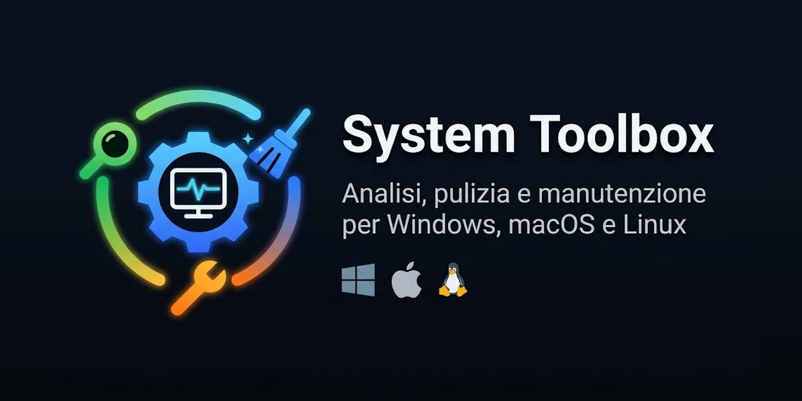

<p align="center">
  
</p>

# System Toolbox

Strumento per **analizzare, pulire e mantenere** il computer performante.
Funziona su **Windows**, **macOS** e **Linux**.

- **Analizza** il sistema senza modificare nulla e segnala solo ciò che richiede attenzione.
- **Pulisce** file temporanei e cache, con livelli di rischio chiari.
- **Ripara** con le operazioni di manutenzione del sistema operativo.

Non corregge niente da solo: ogni intervento lo decide l'utente.

## Avvio rapido

Alla prima esecuzione usa la **simulazione**: fa tutto il giro senza modificare nulla.

| Sistema | Come si avvia |
|---|---|
| Windows | doppio clic su `Windows/Toolbox.bat` |
| macOS | `cd macOS && chmod +x toolbox.command && ./toolbox.command --dry-run` |
| Linux | `cd "Linux Ubuntu" && chmod +x *.sh && ./toolbox.sh --dry-run` |

Su macOS e Linux **non usare `sudo`**: la password viene chiesta solo quando serve.

Istruzioni complete nel README di ogni cartella:

- [Windows](Windows/README.md)
- [macOS](macOS/README.md)
- [Linux](Linux%20Ubuntu/README.md)

## Come funziona

### Livelli di rischio

Ogni operazione dichiara il proprio livello.

| Livello | Significato |
|---|---|
| `[sicuro]` | rimuove solo ciò che il sistema ricrea da sé. Nessuna conferma |
| `[avanzato]` | ferma servizi, rimuove pacchetti o dura a lungo. **Chiede conferma e mostra l'elenco** |
| `[riavvio]` | ha effetto dopo il riavvio |
| `[SCONSIG.]` | eseguibile ma di solito controproducente. Mai inclusa negli insiemi |

### Esiti

Ogni operazione termina con **OK**, **PARZIALE** o **FALLITO**, con il motivo.
I file bloccati perché in uso non sono errori: vengono contati a parte.

### Simulazione

Disattivata di default. Si attiva con `--dry-run` (Windows: `-DryRun`) o dal menu con `S`.

### Log e report

- Ogni sessione scrive un log nella cartella `logs/` (vengono tenuti gli ultimi 15).
- `--report file.html` esporta un report leggibile.
- `--json` produce un riepilogo per altri script.
- Codici di uscita: `0` tutto in ordine, `1` avvisi, `2` problemi.

### Configurazione

Ogni versione ha un file `toolbox.conf.esempio` (Windows: `Toolbox.conf.esempio`).
Copialo togliendo `.esempio` e modifica le soglie. Il file viene solo letto, mai eseguito.

## Le tre versioni

| | Windows | macOS | Linux |
|---|---|---|---|
| Linguaggio | PowerShell 5.1 | bash 3.2 | bash 4+ |
| Interfaccia | finestra grafica + menu testuale | menu testuale + app per il Dock | menu testuale + finestre zenity |
| Operazioni | 27 | 22 | 21 |
| Controlli di collaudo | 57 | 104 | 125 |

## Cosa non fa

Lo strumento esclude di proposito le "ottimizzazioni" che non funzionano o fanno danni:
pulizia del registro, "liberare la RAM", disattivare swap o servizi, deframmentare un SSD,
programmi "cleaner" di terze parti.

## Collaudo

Ogni versione ha una suite di controlli che non tocca il sistema.

```bash
powershell -ExecutionPolicy Bypass -File "Windows\test\Collaudo.ps1"
```

```bash
bash macOS/test/collaudo.sh
```

```bash
bash "Linux Ubuntu/test/collaudo.sh"
```

## Esecuzione automatica

Per farlo girare da solo ogni settimana: [PIANIFICAZIONE.md](PIANIFICAZIONE.md).

## Per chi sviluppa

Le tre versioni hanno la stessa struttura:

```
avvio            menu e orchestrazione
lib/common       versione, configurazione, report, JSON, storico
lib/core         log, esecuzione delle operazioni, privilegi
lib/tasks        elenco delle operazioni
lib/analysis     analisi, sola lettura
lib/ui           visualizzazione
test/            suite di collaudo
```

**Aggiungere un'operazione:** una voce nel registro (`lib/tasks.sh` o `lib\Tasks.ps1`)
e una funzione che la esegue. Dentro la funzione si usa `ctx_note` per le informazioni
e `ctx_fail` per i problemi. Tempi, log ed esito li gestisce il motore.

**Da aggiornare quando escono nuove versioni dei sistemi operativi:**
`$script:CicloDiVita` in `Windows/lib/Analysis.ps1`, `macos_eol()` e `ubuntu_eol()`
nei rispettivi `lib/analysis.sh`.

---

## Licenza

MIT: puoi usarlo, modificarlo e ridistribuirlo liberamente. Testo completo in [LICENSE](LICENSE).
